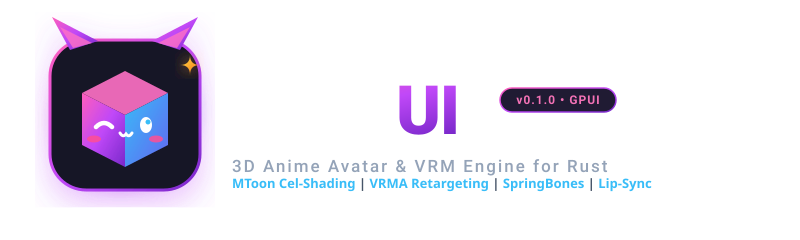
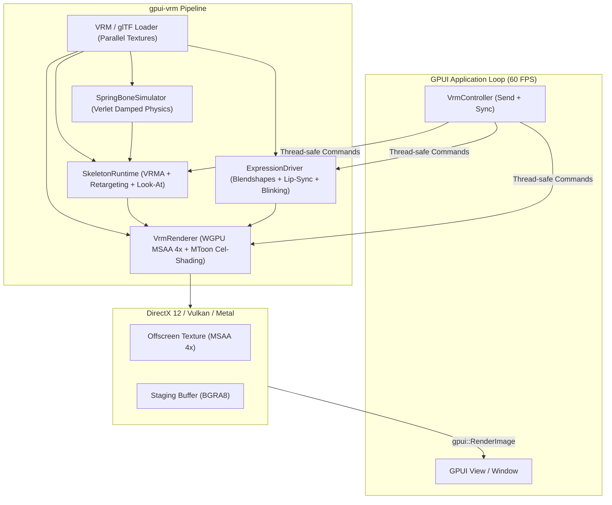

<p align="center">
  
</p>

<p align="center">
  <strong>Native 3D Anime Avatar &amp; VRM Companion Framework for GPUI</strong>
</p>

<p align="center">
  <a href="https://crates.io/crates/gpui-vrm"></a>
  <a href="https://docs.rs/gpui-vrm"></a>
  <a href="LICENSE-MIT"></a>
</p>

---

**WeebUI** (`gpui-vrm`) is a 100% native Rust 3D anime avatar and companion runtime for **GPUI** (the blazing-fast, GPU-accelerated UI framework developed by Zed Industries).

It brings full **VRM 0.x / 1.0** and **glTF 2.0** support to GPUI applications with hardware-accelerated **WGPU** offscreen rendering, **MToon anime cel-shading**, **VRMA skeletal animation retargeting**, **Verlet spring bone physics** (hair and cloth), **morph target facial blendshapes**, and **audio-driven lip-sync**.

---

## ✨ Features

- **🚀 100% Native Rust & GPUI**: Zero Electron, zero WebViews, zero IPC overhead. Seamlessly renders inside GPUI's layout tree using sprite atlas image blitting.
- **🎨 MToon Cel-Shading**: WGSL shader featuring anime-style shading steps (`_ShadeShift`, `_ShadeToony`), hemispheric ambient + directional lighting, Fresnel rim lighting, and inverted-hull backface outline extrusion.
- **⚡ High-Performance Parallel Loader**: Multi-threaded texture decompression (`image` crate via `std::thread::scope`) and zero-copy binary glTF chunk parsing.
- **💃 VRMA Skeletal Retargeting**: Plays standard `.vrma` (`VRMC_vrm_animation`) clips with smooth crossfade blending, arm clearance adjustment, procedural breathing idle sway, and mouse cursor Look-At IK.
- **🌸 Verlet SpringBone Physics**: Real-time simulation of hair, ribbons, sleeves, and skirts with spherical collision detection (`colliderGroups`).
- **🗣️ Facial Blendshapes & Lip-Sync**:
  - Full support for VRM 0.x (`Joy`, `Angry`, `Sorrow`, `Fun`, `Blink`, `A, I, U, E, O`) and VRM 1.0 (`happy`, `sad`, `angry`, `relaxed`, `surprised`, `aa, ih, ou, ee, oh`).
  - Automatic natural blinking with micro-sacadas.
  - Real-time phonetic vowel scheduling + 60Hz RMS audio envelope extraction from WAV sound files.
  - Dynamic runtime emotion registration via `VrmController::register_emotion`.
- **🎮 Interactive Camera Controls**: Mouse drag orbit (yaw/pitch) and scroll-wheel zoom built into the GPUI element.

---

## 🏗️ Architecture



---

## 📦 Installation

Add `gpui-vrm` to your `Cargo.toml`:

```toml
[dependencies]
gpui = "0.2.2"
gpui-vrm = "0.1.0"
```

---

## 🚀 Quickstart

```rust
use gpui::*;
use gpui_vrm::{VrmController, VrmView};
use std::path::PathBuf;

fn main() {
    Application::new().run(|cx: &mut App| {
        let controller = VrmController::new();

        // Trigger expressions and animations from any thread:
        controller.set_emotion("happy");
        controller.play_vrma("idle", true);

        cx.open_window(WindowOptions::default(), |_window, cx| {
            cx.new(|_cx| {
                VrmView::new(
                    "assets/avatar.vrm",
                    Some(PathBuf::from("assets/animations")),
                    controller,
                ).expect("Failed to load VRM model")
            })
        }).unwrap();
    });
}
```

---

## 🎮 Standalone Avatar Viewer Example

You can run the interactive viewer example immediately with any `.vrm` file:

```bash
# Run with your own avatar and optional VRMA animation folder:
cargo run --example avatar_viewer -- path/to/avatar.vrm [path/to/vrma_folder]
```

### Controls in Viewer:
- **Left Mouse Click + Drag**: Smooth camera orbit (yaw and pitch)
- **Mouse Scroll Wheel**: Camera zoom in / out
- **Mouse Movement**: Avatar eyes and head follow the mouse cursor (Look-At IK)
- **Interactive Buttons**: Test standard emotions (`Joy`, `Angry`, `Sorrow`, `Relaxed`, `Surprised`, `Blink`) and phonetic lip-sync.

---

## 🛠️ API Reference

### `VrmController`
Thread-safe (`Clone + Send + Sync`) controller handle for dispatching commands to the avatar from background tasks, audio callbacks, or UI events:

```rust
let ctrl = VrmController::new();

// Set facial emotion (standard VRM presets or custom aliases)
ctrl.set_emotion("joy");

// Trigger lip-sync speech with text and optional WAV bytes
ctrl.speak("Hello, welcome to GPUI!", Some(wav_bytes));

// Play a VRMA animation clip
ctrl.play_vrma("greeting", false);

// Orient Look-At targeting manually (-1.0 to 1.0)
ctrl.look_at_normalized(0.2, -0.1);

// Register custom emotion mapping at runtime
ctrl.register_emotion("smug", EmotionConfig::new(&[("smug_face", 1.0)], false));
```

### `VrmView`
A GPUI `Render` element that embeds the 3D viewport into any layout:

```rust
div()
    .size_full()
    .child(vrm_view_entity)
```

---

## 🇧🇷 Resumo em Português

`gpui-vrm` é um motor 3D completo e nativo em Rust para renderização de avatares VRM 0.x/1.0, animações VRMA, shaders MToon anime cel-shading, física de cabelos/roupas (SpringBones) e lip-sync labial dentro do framework **GPUI**. Foi desenvolvido originalmente como núcleo 3D do projeto Usami e isolado para ser compartilhado como biblioteca de código aberto com toda a comunidade Rust / GPUI.

---

## 📄 License

Licensed under either of:

- Apache License, Version 2.0 ([LICENSE-APACHE](LICENSE-APACHE) or http://www.apache.org/licenses/LICENSE-2.0)
- MIT license ([LICENSE-MIT](LICENSE-MIT) or http://opensource.org/licenses/MIT)

at your option.
